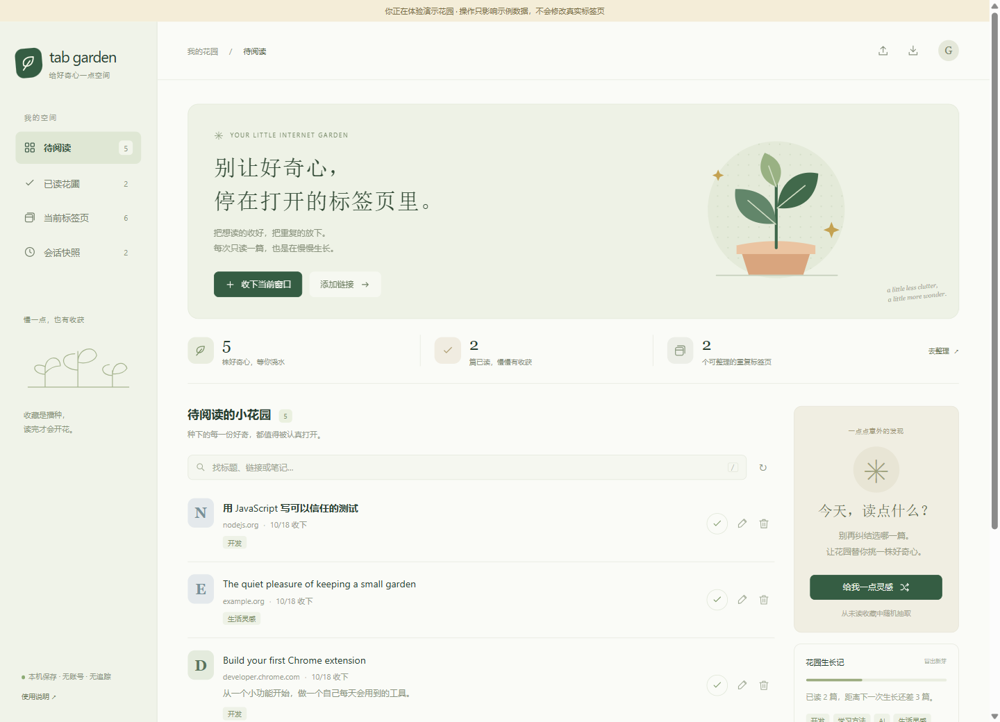
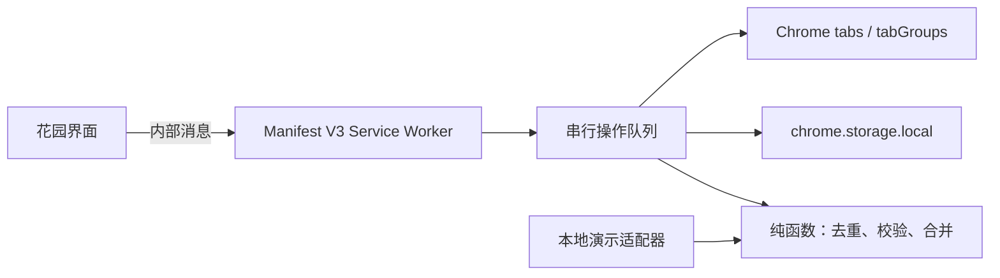

# Tab Garden · 标签花园

**别让好奇心，停在打开的标签页里。** 一个本机优先的 Chrome 浏览器扩展：收好想读的链接，整理重复标签页，随机抽一篇收藏来读。

无账号、无 API Key、无远端服务器、无第三方运行依赖。没有内容脚本，不读取网页正文，不替换浏览器新标签页。



## 它能做什么

- **收下当前窗口**：把普通网页存入待阅读，自动跳过已有收藏，保留你写过的笔记和阅读进度。
- **给收藏留一句话**：标题、标签、笔记与搜索；按 `/` 或 `Ctrl/Cmd + K` 快速找到内容。
- **读点什么**：从未读收藏中随机抽一篇。读完后点勾，花园随阅读数量慢慢生长。
- **标签页整理**：按站点分组，预览重复页后再关闭。保留当前、固定和正在播放音频的页，已有分组不被重新整理。
- **会话快照**：保存当前窗口的网页链接，之后在新窗口重新打开。清理重复页前会自动保存快照。
- **数据带得走**：JSON 导出与合并导入；移除收藏后有 9 秒撤销入口。

## 安装使用

需要支持 Manifest V3 的 Chrome 120+。本项目**尚未上架 Chrome 应用商店**，请通过开发者模式本地加载。

1. 下载仓库 ZIP 并解压，或 `git clone https://github.com/hxl-0926/tab-garden.git`。
2. 打开 `chrome://extensions`，开启开发者模式。
3. 点击“加载已解压的扩展程序”，选择包含 `manifest.json` 的项目文件夹。
4. 在扩展菜单中固定 Tab Garden，点叶子图标打开花园。
5. 第一次是空花园：点击“收下当前窗口”，或手动添加一个链接。

源代码仓库提交了图标，直接加载无需构建。`dist/` 是可选构建产物，未提交到 Git。

## 先体验界面

Node.js 22.14+，不需要 `npm install`：

```sh
npm run preview
```

打开 `http://127.0.0.1:4173`。页面顶部会明确标注**演示模式**：收藏存在该站点的 localStorage，标签整理操作仅作用于模拟数据，不会操作你的真实标签页。演示数据有合成的文章标题和链接，它们不代表读取过网页正文。

## 数据与操作边界

默认只处理当前普通窗口中的 HTTP(S) 网页，跳过隐身页、内部页面、文件页和带账号密码的 URL。标签页查询和收藏不同：快照保留原始网页链接，收藏去重会移除 `utm_*`、`fbclid`、`gclid`、`dclid`、`msclkid` 参数；保留路径大小写、锚点、其他参数和参数顺序。

关闭重复页前会展示清单，保存恢复快照，并在关闭每个标签前重新检查 URL 和保护状态。Chrome 的查询与关闭并不是一个原子操作，用户同时切换页面仍可能引起中途失败；已有快照不会因关闭失败而消失。快照只恢复链接，不能恢复未提交的表单、页面历史、滚动位置或登录状态。分组会调整标签排列，请在预览提示后确认。

| 限制 | 数值 |
| --- | ---: |
| 收藏数 | 2,000 |
| 快照数 | 最近 20 张 |
| 单张快照 | 最多 100 个网页 |
| 一次恢复 | 最多 50 个网页 |
| 导入文件 | 最多 2 MB |

超过快照上限的窗口会明确报错，清理不会继续。超过恢复上限的快照仍可导出，需自行分批打开。扩展数据保存在 `chrome.storage.local`；卸载扩展会删除本机扩展数据，卸载前请导出备份。导入按规范化 URL 合并，已有收藏的笔记和阅读进度优先保留。更多说明见 [隐私说明](PRIVACY.md)。

## 工程设计



所有数据修改由 Service Worker 串行处理，防止多个页面同时读改写导致收藏丢失；异常操作不会阻塞后续队列。只有自己的花园页面可以调用消息处理器。渲染动态内容使用 `textContent`，导入文件的链接协议和数据结构均经过校验。

相关 API 以 [Chrome tabs](https://developer.chrome.com/docs/extensions/reference/api/tabs)、[storage](https://developer.chrome.com/docs/extensions/reference/api/storage)、[tabGroups](https://developer.chrome.com/docs/extensions/reference/api/tabGroups) 官方文档为准。

## 开发与测试

```sh
npm test
npm run build
```

`build` 用 Node 内置模块生成图标并准备 `dist/`。不下载模型、字体或脚本。测试覆盖 URL 语义、并发保存、保护标签、过期清理计划、快照先保存后关闭、写入失败、撤销和导入数据校验。浏览器界面检查与真实扩展验证范围见 [验证记录](docs/VERIFICATION.md)。

GitHub Actions 配置覆盖 Windows/Linux、Node 22/24。学习源码可以从 [学习路线](docs/LEARNING.md) 开始。

真实扩展端到端测试需要安装开发依赖和独立测试浏览器：

```sh
npm ci
npx playwright install chromium
npm run build
npm run test:e2e
```

端到端测试按 [Playwright 扩展测试指南](https://playwright.dev/docs/chrome-extensions) 在隔离的临时 Chromium 配置中加载扩展，使用合成网页，不连接或修改你的日常浏览器资料。

MIT License。初始设计与实现有 AI 协助；没有使用真实用户浏览记录作为示例。
